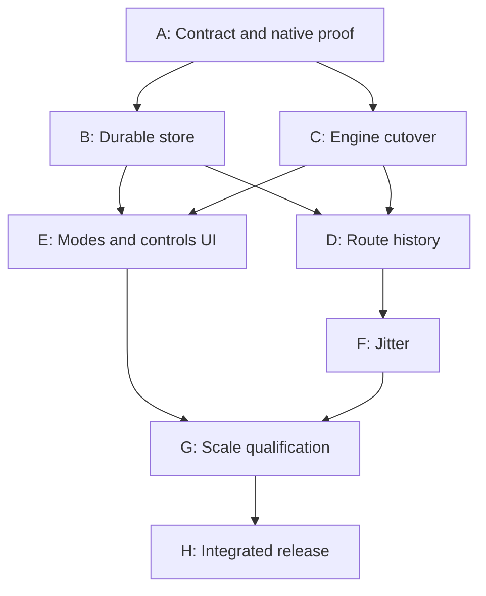

# Route probing, history, controls, jitter, and scale

Status: implementation plan only, based on released Netplot **v0.1.4**. No application implementation, deployment, or privilege changes are authorized by this document. Performance figures below are proposed acceptance targets, not measured capacity claims.

## Requested scope

The numbers retain the user's feature-list numbering.

| Item | Deliverable |
|---|---|
| 1 | Continuous TTL/hop-limit-aware probing, not direct echo requests to previously discovered routers. |
| 2 | Observed route changes, responder identity, and historical route reconstruction. |
| 3 | Durable measurements and route history across process/container restarts. |
| 6 | ICMP, UDP, and TCP probe modes. |
| 7 | Per-trace packet size, destination port, source interface, reply timeout, and send spacing. |
| 8 | Defined, window-correct jitter measurements. |
| 16 | Configurable larger target counts with bounded resources and a validated capacity tier. |

Alerts, MOS, `.pp2` import/export, remote agents, user accounts, and a cross-target analytics dashboard are not part of this change. Access protection remains an operator responsibility.

## Current constraints

- `engine.py` launches `ping -c 1` per destination/hop; `session.py` runs one initial traceroute. Intermediate-hop monitoring is not TTL-limited route monitoring.
- `Sample` stores only round-launch time and RTT-or-null. It cannot distinguish reply kinds, actual probe timing, responder changes, or local failures.
- Stream identity is the hop index. The destination and final hop can share Python deque objects; that is not a durable identity model.
- Only background definitions persist in `sessions.json`; raw samples and minute rollups are memory-only.
- The registry is capped at eight traces, each retaining up to 10,000 samples per stream. Every browser tab keeps its own SSE connection and buffers.
- The independent send-deadline, overlapping-timeout, ordered-publication, and no-fabricated-loss properties introduced in 0.1.3 must survive the engine replacement.

## Architecture decision

Use **one bounded native probe helper per Netplot process/network namespace**, with Python retaining application lifecycle, storage, APIs, and the web UI. The native helper owns the single wire-scheduling authority: monotonic send deadlines, packet spacing, per-probe deadlines, global/per-trace admission, reply correlation, and cancellation. `session.py` must not retain a competing second wire scheduler.

Implement the helper as a small AGPL-3.0-only Rust binary under `native/probe-helper/`, using maintained packet codecs such as pinned `trippy-packet` and OS socket primitives. Reuse packet parsing/building, not another application's round scheduler. The inspected `trippy-packet` 0.13.0 supports IPv4, IPv6, ICMP, UDP, and TCP and declares Apache-2.0; retain its notices and lock/audit dependencies. Pin the chosen Rust toolchain and dependencies when implementing.

A stock `mtr-packet` adapter was investigated, but is not the final transport: it ignores TCP packet-size controls, has integer-second native timeouts, cannot cancel a probe, and collapses useful TCP/ICMP outcomes. Its TCP implementation uses one socket per outstanding connect and a `select()` loop. Disabling requested controls or silently using the old ping engine is not an acceptable cutover. A new helper adds native-code maintenance and security-review obligations; it is justified by these concrete contract gaps, not by performance speculation alone.

### Privilege boundary

- Python/Uvicorn stays non-root. The helper opens the necessary raw sockets during a minimal initialization stage, permanently drops elevated UID/capabilities, and only then processes configuration/probe commands.
- Use a private inherited pipe/socket pair, not a privileged network listener. Version the bounded IPC protocol; reject oversized frames, invalid addresses, unsupported parameters, and unknown commands.
- Use typed requests, numeric resolved IPs, validated interfaces/ports, reusable packet buffers, and preallocated in-flight slots. Do not spawn per packet or allocate a TCP connection/socket per SYN probe.
- Linux containers grant only the helper `CAP_NET_RAW`, not the web interpreter or `NET_ADMIN`; verify the runtime's capability bounding set. Never require `--privileged`.
- Native macOS needs an administrator-installed, root-owned helper in a protected directory with a reviewed socket-opening/privilege-drop mechanism. Never recommend running the web server as root or placing an elevated binary in a user-writable directory.
- Missing helper privileges are an explicit capability/start error. Existing history stays readable; there is no legacy direct-ping or silently degraded protocol fallback.

## Shared measurement contract

Introduce immutable identities before changing consumers:

- `trace_id`: logical collection, independent of browser tabs.
- `profile_version`: protocol, resolved destination/family, source policy, sizes, ports, timeout, spacing, interval, and hop policy.
- `run_generation`: pause/resume/reconfiguration cancellation boundary.
- `opportunity_seq`: allocated at **every scheduled opportunity**, including skipped opportunities. Today's launch-only round sequence cannot identify admission gaps.
- `round_id` and `probe_id`: unique identities; a physical probe produces at most one final outcome.
- `probe_role`: destination or TTL observation; `ttl`/hop-limit is separate from the displayed hop number.
- Probe records include planned time, helper-reported send/receive timestamps, monotonic RTT, responder, protocol outcome, and native error detail when available. Timestamps around the send syscall are not claims of NIC hardware timestamping.
- Store immutable per-round route observations separately from derived route epochs. Historical data must retain the responder actually observed, not inherit today's router at the same TTL.
- Allocate a durable, non-reused event/commit cursor for snapshots, history pages, SSE replay, and exports. Do not use floating-point timestamps as the only deduplication or pagination key.

### Outcome/statistic rules

- A TTL-exceeded response is a valid intermediate-hop response, not packet loss.
- An expected destination ICMP echo response, UDP port-unreachable response, or matching TCP response establishes protocol-specific reachability. A TCP RST demonstrates a responding host/closed port, not a healthy application service; distinguish it from SYN-ACK.
- Genuine no-response loss requires an actually sent probe reaching its own reply deadline.
- Unsupported settings, capacity rejection, cancellation, local send failures, and helper failures are not network packet loss. Keep explicit network-unreachable/error responses separate from silent timeouts; preserve their codes rather than flattening them into RTT-null.
- Return eligible-sample denominators and separate error/gap counts. No eligible measurements means unknown, not a reassuring zero-percent-loss result.
- Commit finalized rounds in launch/opportunity order per trace, exactly once. Cancelled incomplete rounds become gaps, not partially published sample sets. Completed rounds already accepted for durable commit drain through the lifecycle barrier.

## 1. Continuous route-aware probing

Replace the one-time-traceroute/direct-echo combination with repeated TTL/hop-limit probe ladders addressed to the destination. Probe silent TTL positions too; a timeout row must correspond to a real sent packet, not an invented placeholder.

Maintain an explicit destination probe so end-to-end monitoring continues while a route is unknown, silent, or changing. A TTL ladder probe and a destination probe can reach the same address but are distinct physical measurements. Remove deque aliasing: the destination's primary statistics receive exactly one designated destination measurement per round; a terminal ladder response cannot append a second destination sample. Expose roles/IDs in history and export so the two streams cannot be accidentally combined.

Use a default 30-hop ladder limit, bounded expansion within the selected maximum, and periodic exploration beyond a previously observed terminal hop so route growth is discoverable. Destination failure alone does not prove a changed route. Record the last observed route and its freshness while continuing real TTL observations.

**Acceptance:** controlled paths with silent intermediate routers, a silent tail, a shorter/longer replacement route, delayed replies, and out-of-order responses produce correct responder/TTL attribution, independent destination statistics, and no double counting. Packet capture proves the TTL ladder is sent to the destination rather than echoing router IPs.

## 2. Route changes and historical routes

Persist each round's TTL-to-responder observations, including unknown/no-reply positions and multiple responders. Derive route epochs from observed address/terminal-TTL changes, with candidate/confirmed states to avoid treating one missing response as a definite topology change. Retain candidate observations even when the display waits for confirmation; do not discard evidence.

Key intermediate-hop history by profile, TTL, responder/observed path context, and generation, not TTL alone. Do not attribute a timeout's unknown responder to an arbitrary router. A historical focus period reconstructs the observed route for that period. If it spans multiple epochs, display a multi-route indication and offer epoch selection instead of silently averaging different routers into one hop row.

ECMP can produce different responders without a routing configuration change. Preserve and label observed path variation; do not claim that a TTL ladder proves one physical end-to-end path or that every variation is a routing event. Use stable flow identifiers where protocol correlation permits, and retain a per-probe flow identifier when a port/sequence must vary.

The destination stream remains stable across route changes when destination/profile are unchanged; a genuine route-related RTT step must remain visible in destination statistics and jitter.

**Acceptance:** A→B replacement at one TTL, route length changes, A/B alternation under ECMP, temporary non-response, and return to an older route retain correctly attributed history. Dragging focus backward reconstructs the corresponding observations rather than showing today's hop list.

## 3. Durable measurement history

Use stdlib SQLite at `$NETPLOT_DATA_DIR/history.sqlite3`: WAL, `synchronous=FULL`, one dedicated writer, and a bounded read pool. Keep `settings.json` unchanged. Store trace definitions, immutable profiles, run/opportunity records, probes, route observations/epochs, lifecycle/gap events, and composable minute aggregates in the database.

### Commit and recovery

- Every trace's measurements are durable; the existing Background flag controls automatic restart/resume, not whether samples are saved.
- Batch finalized rounds into bounded transactions, initially targeting a maximum 200 ms batch wait. ACK only after COMMIT. Update live caches/counters and publish SSE only after that ACK.
- Transactionally write a complete round, related observations/events, sequence state, and aggregates. Unique IDs prevent duplicate replay. A snapshot reads one durable watermark consistently.
- Pause/reconfigure/archive: stop native admission, cancel unsent work, await native cancellation/barrier ACK, drain previously accepted durable commits, then acknowledge the lifecycle transition. No old-generation publication after successful completion.
- On disk-full, corruption, I/O failure, unsupported schema, or a stalled writer, stop admitting/sending new work and expose a storage fault. Do not continue publishing RAM-only measurements while claiming durable history. If storage is unavailable, do not claim gap events were durably written; expose the last durable cursor and an unavailable interval on recovery.
- A hung filesystem cannot be made safe by timing out an await. Bound API waiting, return failure/unknown durability when needed, and keep the affected traces stopped until recovery.

### Reads, retention, and lifecycle

Use indexed range aggregation, keyset pagination, bounded chunks, and cancellable read workers. Stream exports from a fixed durable watermark; retain full-history export semantics subject to the existing admission/transfer bounds, add optional time filters/cursors for larger histories, and never silently truncate a successful CSV. Pruned cursors return an explicit expiry/truncation response.

Proposed retention targets are 24 hours of raw data and 30 days of minute aggregates, **subject to a configurable total byte quota**; initially evaluate an 8 GiB quota with a separate free-space reserve. These are defaults to validate, not guaranteed lookbacks at every load. Account for DB, WAL, checkpoint activity, and temporary export/backup space. Prune bounded batches without deleting route metadata still referenced by retained data. Report actual earliest raw/aggregate times and resolution in the API/UI.

Separate archive from purge. Closing a trace archives/stops collection while preserving retained history; expose a read-only history picker for active/archived traces. Explicit permanent deletion requires confirmation and removes that trace's data. Background traces resume their saved desired state after restart; other traces remain available for historical inspection but do not auto-start.

**Acceptance:** clean restart, forced process kill before/after COMMIT, crash before publication, slow disk, disk-full, active retention pruning, concurrent export, and pause/delete races preserve every acknowledged round exactly once. Old and new data remain queryable within reported retention bounds; no false packet-loss rows appear during downtime.

## 6. ICMP, UDP, and TCP modes

Implement all three on the same helper, scheduler, identity, timeout, and persistence contracts:

- ICMP echo plus ICMP/ICMPv6 time-exceeded/error correlation.
- UDP probes with ports/identifiers that make quoted ICMP errors attributable to the correct trace and probe; destination port-unreachable is a successful destination response.
- Crafted TCP SYN probes, explicit SYN-ACK/RST classification, configurable destination port and packet size, and correct quoted-error/sequence correlation. Do not substitute successful full `connect()` calls or leave application connections open.

Support the address families/platforms declared by the product and report capabilities before creation or restore. Changing protocol creates a new immutable profile version; never blend earlier ICMP samples with a later TCP/UDP profile.

**Acceptance:** listeners/open ports, closed ports, filtered traffic, destination-unreachable responses, NAT, IPv4/IPv6, duplicate destinations, late replies, token reuse boundaries, and malformed/truncated packets are exercised. On-wire capture verifies packet type, TTL, size, source, port, and probe rate.

## 7. Advanced per-trace controls

Keep the Packet dropdown in the main toolbar and add an adjacent **Options** disclosure for per-trace controls. Do not put these in the global internal-CIDR/InfluxDB Settings dialog.

| Setting | Proposed contract |
|---|---|
| Protocol | ICMP, UDP, TCP; backend capability validated. |
| Interval | Existing presets including 1 and 2.5 seconds; controls send cadence, not reply timeout. |
| Reply timeout | Default 3 seconds; finite positive duration, proposed range 100 ms–30 s; honored per packet without rounding into an earlier timeout. |
| Send spacing | Default 25 ms between TTL probes; proposed range 0–1,000 ms; validate combined hop count/interval/resource feasibility. |
| Packet size | Explicit **total IP datagram bytes**; protocol/family-specific minimums and documented maximum. Proposed ICMP defaults are 84 bytes IPv4 / 104 bytes IPv6 (56 payload bytes); TCP defaults are 40 / 60 bytes without options. TCP size must actually be honored, not an ignored input. |
| Destination port | 1–65,535; default TCP 443 / UDP 33,434; not applicable to ICMP. |
| Source interface | Auto or an interface actually visible to the Netplot runtime/network namespace; never imply a container can select a host NIC it cannot access. |
| Hop limit | Default 30; proposed maximum 64; subject to profile admission and packet-spacing feasibility. |

The ranges above are proposed product limits, to finalize through wire/platform validation. For spacing, reject profiles that cannot send their ladder within the advertised cadence; do not silently alter the interval.

Idle controls are editable. Running/transitional profiles are inspectable but locked. Paused edits are staged; Apply and Resume creates a new profile version while retaining prior data. Show the active protocol/profile and indicate historical profile boundaries. Revert restores the saved profile draft without deleting history. Unavailable saved interfaces/protocols remain visible with a reason, not replaced by a guessed default. Failure to load capabilities blocks starting/resuming, not a silent default-protocol fallback.

Use native labels with units, disclosure semantics, visible focus, keyboard operation, non-color error states, and field-linked validation. Do not clamp or discard invalid typed input. Verify the actual surface at narrow widths and enlarged text; source recommendations are not rendered accessibility proof.

**Acceptance:** profile values round-trip across tab switches and restart; paused edits preserve old history; invalid/cross-field-infeasible settings fail before sending; TCP size, interface, timeout, and spacing are verified on wire. Keyboard and error/recovery paths work without destructive Reset.

## 8. Jitter

Use PingPlotter's published definition: mean absolute difference between successive RTTs, not standard deviation, max-minus-min, or RTP's smoothed jitter estimator.

For a focused window, sum `abs(rtt[i] - rtt[i-1])` over eligible pairs and divide by eligible pair count. Both endpoints must be inside the effective window. The published example `[136, 184, 115, 148, 125]` must yield **43.25 ms**.

Eligibility breaks on loss/error, an unsent/cancelled opportunity, pause/run boundary, or profile change. Intermediate-hop pairs also require the same responder/stream identity. Destination pairs do **not** break merely because the observed route changed when the destination/profile remained the same. With no eligible pair, return null/“—”, not zero. Loss/gap boundary behavior is our explicit policy: the vendor's published article does not define those cases.

Minute aggregates retain internal absolute-delta sum, eligible-pair count, and first/last probe boundary identity/status/RTT. Merge sums and eligible boundary pairs; never average per-bucket jitter averages. For partial bucket edges, use raw data when retained; otherwise return bucket-aligned effective bounds and mark resolution rather than claim exact arbitrary-window statistics.

Expose jitter in the hop table, destination caption/summary, snapshot/history statistics, and monitoring/export contracts where applicable. Use the same profile/window/identity as the associated RTT/loss statistics.

**Acceptance:** the vendor example, constant RTTs, zero RTT, one sample, all loss, loss gaps, skipped opportunities, route/responder changes, destination route steps, pause/resume, focus edges, and raw-versus-rollup composition agree across server and client.

## 16. Larger target counts

Initial proposed qualification target: **100 distinct active destinations, one-second interval, up to 30 TTL probes plus one destination probe, three-second timeout**, on a defined Linux reference environment of 4 vCPU, 8 GiB RAM, and local SSD storage. Qualify both published Linux architectures; validate native macOS semantics separately. Do not advertise unbounded targets or this performance before measuring it.

| Profile | Probe opportunities/second | Worst-case in-flight requests at 3 s |
|---|---:|---:|
| 8 traces × 31 probes × 1 s cadence | 248 | 744 |
| 32 traces × 31 probes × 1 s cadence | 992 | 2,976 |
| 100 traces × 31 probes × 1 s cadence | 3,100 | 9,300 |

These are workload calculations, not CPU/memory/storage benchmarks. At the largest tier, raw history can grow by tens of GiB/day depending on actual schema/index size. Retention and storage capacity must be measured together.

- Replace the fixed eight-trace constant with operator-configurable, validated limits and global packet-rate, in-flight, pending-round, queue-byte, and cache-byte budgets. Reserve capacity for the full requested profile before accepting creation/reconfiguration; reject an infeasible profile with a machine-readable reason.
- Use fair per-trace queues and phased deadlines so one slow/large trace cannot monopolize the helper. No waiting unboundedly for a semaphore after a round has supposedly launched. Transient overload records an explicit measurement gap; it is not packet loss or an invisible interval change.
- Keep hot RAM tails bounded by a global budget; historical reads use SQLite. Do not multiply today's 10,000-sample deques and all minute buckets by 100 traces.
- Keep detailed SSE and dense browser buffers for the active trace, with a small bounded cache. Inactive traces continue server-side collection. Use a scrollable/searchable trace selector, not 100 always-streaming tab buffers. This is navigation for collection scale, not a new analytics dashboard.
- Snapshots carry a durable cursor; SSE resumes after it and deduplicates by event identity. Overflow/expired replay requires explicit resynchronization, not a claim of complete raw coverage.
- Bound forward/reverse DNS workers, queues, lookup duration, and cache size. Slow DNS must not block measurement or restore; do not free worker capacity while a timed-out underlying resolver call is still running.
- Keep snapshot/history/export concurrency limits, stable read watermarks, and bounded monitoring-label cardinality. Expose achieved send cadence, native-resource usage, backlog/faults, skipped opportunities, and actual retention for verification.

**Acceptance target:** within the qualified workload, at least 99% of scheduled opportunities launch within ±100 ms, with no sustained skipped rounds, no helper exhaustion, and no intentional cadence stretching. Proposed responsiveness targets: snapshot p95 ≤250 ms, first history page p95 ≤500 ms, and an 8-hour soak with bounded RSS/FDs/DB/WAL size. Record CPU, disk latency/write volume, actual retention, and cancellation/restart latency. If the tier fails, optimize the bottleneck or obtain an explicit scope decision; do not describe 100 traces at an effective ten-second cadence as one-second support.

## Implementation work packages and dependencies

- **A — Contracts and native proof:** structured profiles/outcomes/identities; helper IPC/security boundary; real ICMP/UDP/TCP TTL and size/timing/cancel proof on supported platforms.
- **B — Durable store:** SQLite schema/migrations, atomic round commits, cursors, retention, read/export paths, archive/purge lifecycle.
- **C — Engine cutover:** native scheduler/admission, helper packaging, session lifecycle/barriers, removal of direct-ping/traceroute paths and deque aliasing.
- **D — Route history:** immutable observations, derived route epochs/variation, historical focus and responder-safe queries.
- **E — Modes and controls UI:** capability endpoint, per-trace Options, saved profile revisions, native ICMP/UDP/TCP controls, restart validation.
- **F — Jitter:** shared statistic definition, raw queries, composable aggregates, focused table/summary/metrics.
- **G — Scale qualification:** global budgets/fairness, bounded hot/browser state, active-trace SSE, benchmark/soak and limit tuning.
- **H — Integrated release:** migrate every caller/test/doc, independent review, multi-platform/multi-architecture smoke, migration rehearsal, rollback procedure.

After A freezes the shared contract, B and C can proceed concurrently.

Use one integration owner. Freeze shared types before parallel source edits; assign separate owners for the native engine, database/read APIs, and client integration. Review each complete package, then run the integrated acceptance matrix. No compatibility aliases, hidden old-engine fallback, or “feature complete” claims while selected items are disabled/unimplemented.

### Likely source changes

- New `native/probe-helper/` binary crate and native protocol/packet tests.
- `engine.py`: helper client, capabilities, structured request/result handling; retain only applicable host validation/resolution utilities.
- `session.py`: profile/run/stream identities, durable publication coordinator, route-state integration and lifecycle fences; retire old subprocess scheduling/aliasing.
- `persistence.py` plus new `history.py`: one-time legacy import and SQLite lifecycle/read/write/retention.
- `web.py`, `metrics.py`: capability/profile/route/history APIs, cursor-aware snapshots/SSE/export, jitter/outcome/gap semantics and bounded status metrics.
- `static/index.html`, `static/app.js`, `static/style.css`: per-trace controls, profile/route selection, durable history access, jitter, active-trace streaming and bounded navigation/cache state.
- Docker/native packaging, `.gitignore`, `.dockerignore`, workflows and smoke scripts: helper binary/permissions, native dependency notices, database/WAL exclusions, required real protocol tests. Remove obsolete ping/traceroute runtime dependencies and incidental argv/source-text tests; retain behavioral regressions that still apply.
- README/spec/implementation notes: current feature claims, API/CSV/schema changes, privilege requirements, migration, storage/privacy and qualified limits.

## Migration, rollback, and release gates

1. Before any production cutover, back up the external data volume and export still-live legacy raw history. Previously lost RAM-only data cannot be reconstructed; do not imply otherwise. CSV backup/import compatibility is not a new `.pp2` import feature.
2. Validate existing `sessions.json` using its current closed-schema/quarantine rules; import definitions into SQLite in one transaction with an explicit migration marker. Do not use “trace table happens to be empty” as the import guard. Preserve the original file as a rollback artifact and never resurrect it after all imported traces are deliberately removed.
3. `settings.json` stays intact. Translate legacy defaults explicitly; background flags become auto-resume policy. New profiles record the new measurement method so direct-echo legacy results cannot be presented as TTL-engine results.
4. New runtime reads/writes one database path only; no JSON/DB toggle or simultaneous authorities. Back up/checkpoint SQLite correctly, or use SQLite's online backup API; copying a live DB file alone is not a backup of its WAL state.
5. Document intentional API/SSE/CSV changes and update every bundled caller. A **0.2.0** release is the proposed integration boundary; do not retag 0.1.4 or relabel earlier licensing.
6. Rollback restores the pre-migration volume and previous release image. Preserve the newer DB separately before rollback; an older binary cannot consume or safely merge it. No pretend forward/backward schema compatibility.
7. Required proof: deterministic outcome/identity/route/storage/jitter regressions; native packet/parser fuzzing and independent security review; real controlled network topologies, open/closed/filtered endpoints, packet capture, storage crash/fault tests, 100-target capacity/soak; actual browser controls/history/route-focus verification; Linux amd64/arm64 and native macOS support checks. Privileged topology setup is test-only and isolated, never a requirement for the production web process.
8. Develop/build/test on the documented development host or Actions. Production deployment and any native-helper privilege installation remain separate, explicitly authorized operations.

## Sources and verification limits

This is a source/documentation design, not an executed native-engine or capacity experiment. The native helper does not exist yet. UI input was source-level planning, not live visual/accessibility verification. Native installation mechanics, complete protocol error matrices, and the reference tier must pass package A/G gates before implementation is accepted or performance is advertised.

- Current source baseline: [Netplot v0.1.4](https://github.com/jschert/netplot/tree/v0.1.4).
- [PingPlotter engine options](https://www.pingplotter.com/manual/packetoptions/).
- [PingPlotter route history](https://www.pingplotter.com/manual/route_changes/).
- [Pingman jitter definition and worked example](https://www.pingman.com/kb/print-57.html). The article documents the formula, not modern loss/gap handling.
- [mtr-packet protocol/source](https://github.com/traviscross/mtr/tree/master/packet) and [manual](https://github.com/traviscross/mtr/blob/master/man/mtr-packet.8.in): evaluated transport alternative, not the selected final engine.
- [Trippy packet codec](https://docs.rs/trippy-packet/0.13.0/trippy_packet/) and [crate version/license metadata](https://crates.io/api/v1/crates/trippy-packet/0.13.0).
